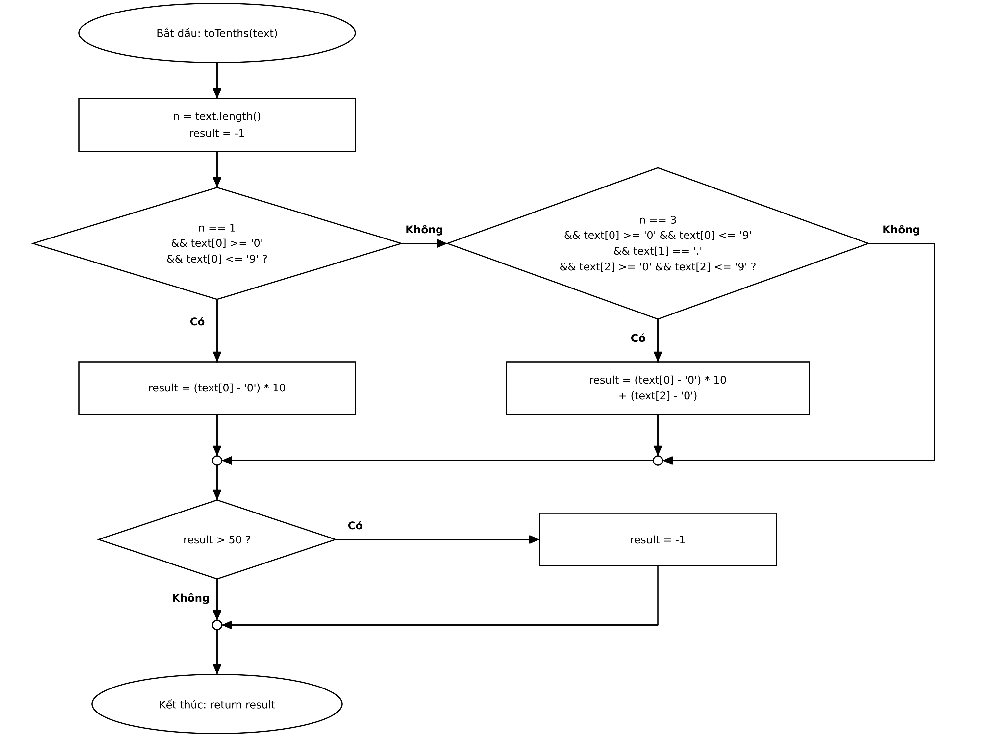

# T02 – Struct + đọc rating: `struct Product`, `struct StockItem`, `toTenths()`

Assignee: Tố Châu · Reviewer: Quang Linh

## Struct

| struct | Trường | Kiểu | Ghi chú |
|---|---|---|---|
| `Product` | `id`, `name`, `category`, `brand` | `string` | đọc từ products.csv |
| | `price` | `long long` | VND, số nguyên |
| | `ratingTenths` | `int` | rating × 10, ví dụ 4.7 → 47 |
| `StockItem` | `storeId`, `productId` | `string` | đọc từ inventory.csv |
| | `stock` | `int` | ≥ 0 |

Vì sao lưu rating dạng "phần mười" (số nguyên): nếu dùng số thực, 4.7 − 4.4 trên máy tính ra 0.30000000000000027, nên so `< 0.3` có thể sai. Dùng số nguyên thì |47 − 44| = 3, và `3 < 3` là sai, đúng như đề.

## `toTenths(text)`

Input: `text` – chuỗi rating đọc từ CSV, ví dụ `"4.7"`.
Output: số nguyên 0..50 (rating × 10), hoặc **-1** nếu chuỗi không hợp lệ.

Hàm chỉ có một lệnh `return` ở cuối.



Hình có nhúng sơ đồ: mở bằng draw.io (File → Open from → Device → chọn tệp này) để sửa.

Pseudocode:

```
FUNCTION toTenths(text)
    n = độ dài text
    result = -1
    IF n == 1 AND text[0] là chữ số THEN                    // dạng "5"
        result = (text[0] - '0') * 10
    ELSE IF n == 3 AND text[0] là chữ số AND text[1] == '.'
            AND text[2] là chữ số THEN                       // dạng "4.7"
        result = (text[0] - '0') * 10 + (text[2] - '0')
    END IF
    IF result > 50 THEN                                      // lớn hơn 5.0
        result = -1
    END IF
    RETURN result
```

`text[0] - '0'` đổi ký tự chữ số thành số: `'4' - '0'` = 4.

Ví dụ:

| text | Kết quả | Lý do |
|---|---|---|
| `"4.7"` | 47 | dạng d.d |
| `"5"` | 50 | dạng d |
| `"0.0"` | 0 | |
| `"5.0"` | 50 | đúng biên 5.0, vẫn hợp lệ |
| `"5.1"` | -1 | 51 > 50 |
| `"4.75"` | -1 | dài 4 ký tự |
| `"4,7"` | -1 | ký tự giữa không phải `'.'` |
| `"abc"` | -1 | không phải chữ số |
| `""` | -1 | chuỗi rỗng |

Cách gọi (T03 sẽ dùng):

```cpp
p.ratingTenths = toTenths(f[5]);
if (p.ratingTenths == -1) {
    // rating sai -> in cảnh báo, bỏ dòng
}
```
