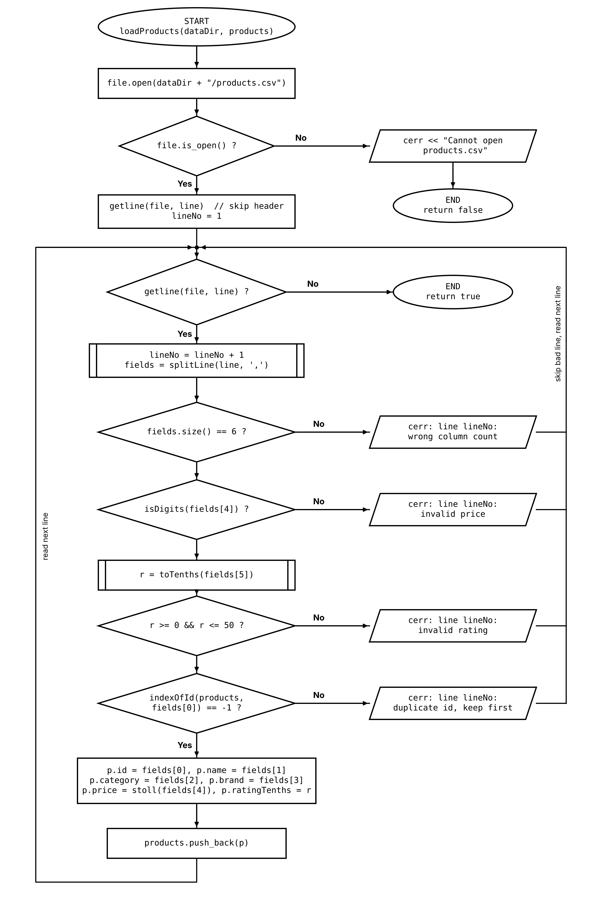

# T03 – loadProducts(dataDir, products)

Reads `products.csv` into the `products` array, skipping bad lines and printing a warning with the line number to `cerr` (brief section 4 and TC04).

**Input:** `dataDir` – data folder (`string`), `products` – result array (`vector<Product>&`, initially empty).
**Output:** `true` if the file could be opened (even when it is empty), `false` if it could not. `products` holds the valid rows in file order.

Depends on T02: `struct Product { id, name, category, brand, price (long long), ratingTenths (int) }` and `int toTenths(string text)` – returns rating × 10, or −1 if the text is not a valid rating.



Editable draw.io file: [T03-load-products.drawio](T03-load-products.drawio).

## Pseudocode

```
FUNCTION loadProducts(dataDir, products)
    OPEN file dataDir + "/products.csv"
    IF file is not open THEN
        PRINT to cerr "Cannot open products.csv"
        RETURN false
    END IF
    READ one line                              // skip header
    lineNo = 1
    WHILE READ line from file
        lineNo = lineNo + 1
        fields = splitLine(line, ',')
        IF fields.size() != 6 THEN
            PRINT to cerr "Warning: line " + lineNo + ": wrong column count"
            CONTINUE
        END IF
        IF NOT isDigits(fields[4]) THEN        // empty, negative or non-numeric price
            PRINT to cerr "Warning: line " + lineNo + ": invalid price"
            CONTINUE
        END IF
        r = toTenths(fields[5])
        IF r < 0 OR r > 50 THEN               // rating must be 0.0 to 5.0
            PRINT to cerr "Warning: line " + lineNo + ": invalid rating"
            CONTINUE
        END IF
        IF indexOfId(products, fields[0]) != -1 THEN
            PRINT to cerr "Warning: line " + lineNo + ": duplicate id " + fields[0] + ", keep first"
            CONTINUE
        END IF
        p.id = fields[0]; p.name = fields[1]; p.category = fields[2]; p.brand = fields[3]
        p.price = stoll(fields[4]); p.ratingTenths = r
        products.push_back(p)
    END WHILE
    RETURN true
END FUNCTION
```

### Helper functions (part of T03)

```
FUNCTION splitLine(line, sep)              // split a line on commas
    fields = empty list; cur = ""
    FOR each character ch in line
        IF ch == sep THEN fields.push_back(cur); cur = ""
        ELSE IF ch != '\r' THEN cur = cur + ch
    END FOR
    fields.push_back(cur)
    RETURN fields

FUNCTION isDigits(text)                    // 1 to 15 characters, only digits 0–9
    IF text == "" OR text.length() > 15 THEN RETURN false   // 15 digits max so stoll cannot overflow
    FOR each character ch in text
        IF ch < '0' OR ch > '9' THEN RETURN false
    RETURN true

FUNCTION indexOfId(products, id)           // linear search, -1 if not found
    FOR i = 0 TO products.size() - 1
        IF products[i].id == id THEN RETURN i
    RETURN -1
```

`indexOfId` uses linear search because the array is not sorted yet while the file is being read. The recursive binary search (`findProduct`, T05) is only used after `sortProductsById`.

## Expected results (for TC04, TC05)

| Command | Warnings on cerr | Valid products |
|---|---|---|
| `bin/p5 data/sample P001` | none | 8 |
| `bin/p5 data/full P001` | line 42: invalid price (P041, −100000); line 43: wrong column count (P042); line 44: duplicate id P005, keep first; line 45: invalid rating (P043, 5.6) | 40 |
| `bin/p5 data/edge/dirty P001` | line 3: invalid price (P002, empty); line 4: invalid price (P003, −5) | 1 |
| `bin/p5 data/edge/empty P001` | none; `findProduct` then reports P001 not found | 0 |

Assumptions: a price of 0 is accepted (the brief only forbids negative prices); an empty line in the middle of the file counts as a wrong column count and gets a warning.
